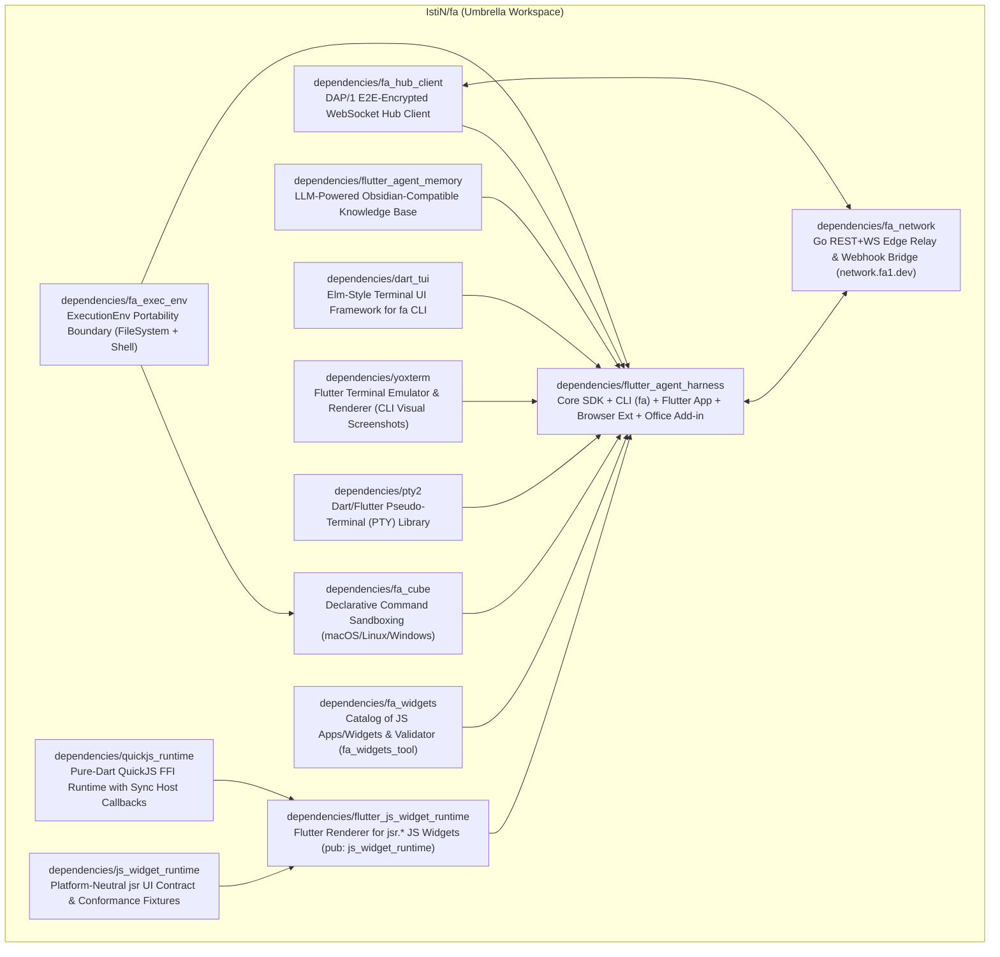

# Fa Umbrella Repository (`IstiN/fa`)

You are the autonomous FA agent for **`IstiN/fa`** — the multi-repository umbrella project for the [Fa](https://fa1.dev) ecosystem under the `IstiN` GitHub organization.

When running via `fa-universal` (or locally after running `bash setup/checkout.sh`), all child repositories declared in `.dmtools/repositories.json` are checked out under `./dependencies/<repo-name>/`.

---

## Ecosystem Architecture & Repository Map



### Primary Repositories (`.dmtools/repositories.json`)

| Local Path (`./dependencies/...`) | GitHub Repo | Env Var | Role & Key Details |
|---|---|---|---|
| `dependencies/flutter_agent_harness` | `IstiN/flutter_agent_harness` | `$FA_HARNESS_DIR` | **Main Monorepo**: Pure-Dart SDK (`lib/`), `fa` CLI (`bin/`, `lib/src/cli/`), Flutter App (`flutter_app/`), UI kit (`packages/fa_ui`), LLM adapters (`packages/fa_llm`), self-hosted DAP hub (`packages/dap_hub`), browser extension (`browser_ext/`), Outlook add-in (`office_addin/`). Read `dependencies/flutter_agent_harness/AGENTS.md` before editing! |
| `dependencies/fa_network` | `IstiN/fa_network` | `$FA_NETWORK_DIR` | **Go Edge Service (`network.fa1.dev`)**: People-facing REST+WS relay between browsers/apps/webhooks and the DAP hub's E2E-encrypted channels. Relay-only (ciphertext-only), `docs/openapi.yaml` is law, CRAP ≤ 12 (`./bin/crap4go`), max 500 lines per `.go` file. |
| `dependencies/fa_cube` | `IstiN/fa_cube` | `$FA_CUBE_DIR` | **Command Sandboxing**: Declarative sandbox profiles (`lib/src/cube/` in harness) + OS kernel backends (`sandbox-exec` on macOS, `unshare` on Linux, Job Object on Windows). Pure Dart in `lib/`, `dart:io` behind `lib/io.dart`. |
| `dependencies/fa_widgets` | `IstiN/fa_widgets` | `$FA_WIDGETS_DIR` | **JS Widget Catalog & Validator**: Curated `jsr.*` widgets (`widgets/<id>/manifest.json` + `widget.js`) published as rolling release zips + `catalog.json`, plus the `fa_widgets_tool` validator used by `flutter_app` and CI. |
| `dependencies/fa_hub_client` | `IstiN/fa_hub_client` | `$FA_HUB_CLIENT_DIR` | **DAP/1 Client (`pub: fa_hub_client`)**: Signed WebSocket client (`MessagingRepository`) delivering E2E-encrypted frames into `Agent.externalSteeringSource` and backing `~/.dap` identity/channels. |

### Supporting First-Party Packages (Checked Out Together)

| Local Path (`./dependencies/...`) | GitHub Repo | Env Var | Role & Key Details |
|---|---|---|---|
| `dependencies/flutter_agent_memory` | `IstiN/flutter_agent_memory` | `$FA_MEMORY_DIR` | **Long-Term Memory (`pub: flutter_agent_memory`)**: Markdown knowledge base (`note/`, `question/`, `answer/`, `person/`, `deleted/` tombstones, union merge drivers) backing `memory_add` / `memory_search` / `memory_list` / `memory_delete`. |
| `dependencies/fa_exec_env` | `IstiN/fa_exec_env` | `$FA_EXEC_ENV_DIR` | **Execution Environment (`pub: fa_exec_env`)**: `ExecutionEnv` (FileSystem + Shell), `CancelToken`, sealed exceptions. Foundation for `flutter_agent_harness` and `fa_cube`. |
| `dependencies/flutter_js_widget_runtime` | `IstiN/flutter_js_widget_runtime` | `$FA_FLUTTER_JSR_DIR` | **Flutter JS Widget Runtime (`pub: js_widget_runtime`)**: Renders `jsr.*` JS widgets as native Flutter UI (QuickJS / JSC / Web Worker, 3D/voxel bridge, WebView host). |
| `dependencies/js_widget_runtime` | `IstiN/js_widget_runtime` | `$FA_JSR_SPEC_DIR` | **JSR UI Contract**: Platform-neutral JSON node schema, semantics, and conformance fixtures (`docs/conformance/PROTOCOL.md`) shared across Flutter, Android, Apple, and React renderers. |
| `dependencies/quickjs_runtime` | `IstiN/quickjs_runtime` | `$FA_QUICKJS_DIR` | **QuickJS FFI (`pub: quickjs_runtime`)**: Pure-Dart QuickJS 2024-01-13 runtime over `dart:ffi` with synchronous host callbacks (`NativeCallable`). |
| `dependencies/dart_tui` | `IstiN/dart_tui` | `$FA_DART_TUI_DIR` | **Terminal UI (`pub: dart_tui`)**: Elm-style (Model–Update–View) TUI framework + `LineEditor` powering the interactive `fa` CLI. |
| `dependencies/yoxterm` | `IstiN/yoxterm` | `$FA_YOXTERM_DIR` | **Terminal Emulator & Screenshot Renderer (`pub: yoxterm`)**: High-performance fork of `xterm.dart` (`Terminal` + `TerminalView`). Its pure-Dart core is vendored in `flutter_agent_harness/vendor/xterm` for PTY tests (`test/integration/pty_harness.dart`), while `flutter_app/test/cli_visual/` uses `TerminalView` to render real terminal PNG screenshots of the `fa` CLI. |
| `dependencies/pty2` | `IstiN/pty2` | `$FA_PTY2_DIR` | **Pseudo-Terminal (`pub: pty2`)**: Fork of `pty2` with `pid` access and teardown fixes, vendored in `flutter_agent_harness/vendor/pty2` to drive real PTY subprocesses for `fa` CLI integration and visual screenshot tests. |

---

## Working Rules in the Umbrella Repo

1. **Inspect Sub-Repo Context First**:
   - Each repository under `dependencies/<repo>/` has its own `AGENTS.md` and quality gates (`scripts/pre-commit`, `crap4dart`, `crap4go`, etc.). Always read `dependencies/<repo>/AGENTS.md` when answering deep architectural questions or making changes in that repo.
2. **Refreshing / Checking Out Dependencies**:
   - In CI (`fa-universal`), `.dmtools/repositories.json` is automatically checked out in parallel into `./dependencies/` before `fa` starts.
   - Locally, you can run `checkout.sh` directly from `IstiN/dmtools-agents` (or a local clone of `dmtools-agents`):
     ```bash
     bash ../dmtools-agents/setup/checkout.sh
     ```
3. **Cross-Repo Changes & PRs**:
   - Each folder under `dependencies/<repo>` is a full git clone with push credentials configured on `origin`.
   - To make code changes in a child repo: `cd dependencies/<repo>`, create a feature branch, run that repo's tests/gates, commit as `ai.teammate <agent.ai.native@gmail.com>`, push, and open a PR against `IstiN/<repo>` via `gh pr create` or `dmtools`.
   - Never commit the `dependencies/` directory itself into `IstiN/fa` (it is git-ignored).
4. **Long-Term Memory & Scripts**:
   - Umbrella-level cross-repo knowledge lives in `.fah/memory` in this repository (`IstiN/fa`, configured via `.fah/config.yaml`). Use `memory_search` before tasks and `memory_add` to record durable cross-repo architectural facts.
   - Helper scripts placed in `scripts/` and memory in `.fah/memory` are automatically committed and pushed back to `IstiN/fa` at the end of each `fa-universal` run.
